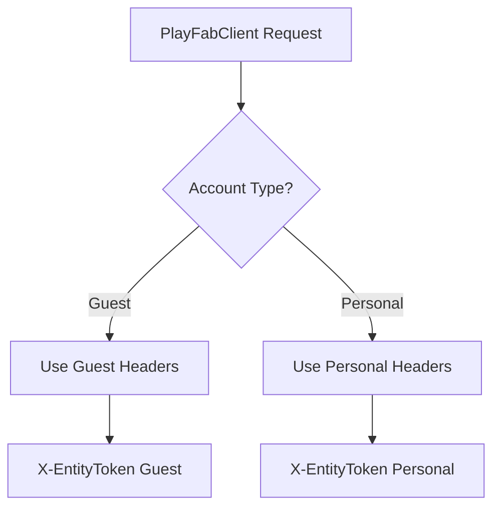

# PlayFabClient Overview

`PlayFabClient` communication to PlayFab endpoints. It facilitates catalog searches, creator item pagination, local caching, guest registration, Xbox Live authentication, and purchase workflows.

### Connection & Timeout Policy
* Uses a persistent, singleton `HttpClient` to optimize network resources instead of spawning ephemeral connections.
* **Connection Timeout**: 10 seconds.
* **Idle Timeout**: 30 seconds.

## Authentication Schemes

`PlayFabClient` manages separate credentials and header states for two user scopes: **Guest Accounts** and **Personal Accounts**.



### 1. Guest Authentication Flow

When using the guest account, PlayFab requires signature validation or RSA payload encryption. Credentials (Custom ID and Player Secret) are persisted locally in `api.json`.

#### Guest Credential Generation
* **Custom ID**: Generated via `genCustomId()` as `MCPF` followed by a secure 16-byte random hex string (e.g., `MCPF7B4A...`).
* **Player Secret**: Generated via `genPlayerSecret()` as a secure 32-byte random base64-encoded string.

#### Encrypted Login (Guest Account Creation)

1. Fetches Mojang's Cryptographic Service Provider (CSP) public key from `/Client/GetTitlePublicKey`.
2. Decodes the public key from the little-endian CSP binary format.
3. Encrypts the custom ID and player secret payload using RSA-PKCS#1.
4. Posts the ciphertext in the `EncryptedRequest` parameter with `CreateAccount: true`.

#### Normal Login Sequence (Existing Account Session)
For subsequent logins with an existing cached account, the request is signed with HMAC-like SHA-256 signatures:
* **`X-PlayFab-Timestamp`**: The current ISO 8601 UTC timestamp.
* **`X-PlayFab-Signature`**: A Base64 SHA-256 hash of:
  `[Request-Body].[Timestamp].[Player-Secret]`

### 2. Personal (Xbox Live) Authentication Flow

Personal accounts utilize standard Xbox Live tokens.

* **Xbox Authentication**: Exchanges an Xbox Live token using `/Client/LoginWithXbox`.
* **Session Ticket & Entity Token**: Parses the returned `SessionTicket` and `EntityToken`, dynamically caching the entity token in `_personalHeaders` under the `X-EntityToken` key.
* **User Information**: Fetches user-specific publisher data (e.g., `GamertagHint` for username retrieval) via `/Client/GetUserPublisherData`.

## Token Cache Lifetime & Validation

To minimize authentication requests, guest tokens are cached locally alongside their expiration timestamps.
* Guest tokens are saved via `saveGuestEntityToken(token, expiration)` and restored during initialization using `restoreGuestEntityTokenFromCache()`.

## Catalog & Query Methods

### 1. Catalog Queries

#### `search(String orderBy, String filter, int top, int skip, String searchName)`
Performs a query against `/Catalog/Search`.

#### `uuidSearch(String dlcId)`
Retrieves a specific catalog item directly by its UUID using the `/Catalog/GetPublishedItem` endpoint.

#### `searchUUID(...)` & `multipleUUIDSearch(...)`
Queries and maps multiple PlayFab item IDs. `multipleUUIDSearch` automatically groups and queries lists of IDs in chunks of up to **300 items** per call.

### 2. Screen Layout & Component Queries

Retrieves a list of product IDs aggregated under specific marketplace headers (e.g. to get new updated, new dlc items):
* **`getProductIdsByHeaderComponent(String headerText)`**: Searches recent query manifests (`QueryManifest_V2.1.0`) to find queries matching a specified `headerText`. Returns a collection of product IDs or tags.
* **`getItemsByHeaderComponent(String headerText)`**: Resolves the retrieved product IDs into detailed catalog items.

### 3. Creator Items & Store Config

Search for items matching a specific creator's account identifier (e.g., Mojang's ID: `master_player_account!301F442C3B63DC20`).
* **`searchCreatorItemsPaginated`**: Performs paginated queries filtered by creator ID and optionally categorized by content type tags (texture packs, worlds, mashups, addons, skins, or capes).
* **`getCreatorItemCount`**: Concurrently performs multiple queries to compile a map of item counts per category for the specified creator.
* **`getCreators`**: Parses the store configuration (`StoreConfig_V1.1`) display properties to extract a list of registered creators (`filterId` and `filterName`).

## Purchase Workflow

### `purchaseItemById({required String itemId, required String expectedPrice})`
Buy items via virtual currency (Minecoins):
* Calls the `/Catalog/PurchaseItemById` endpoint with the title's Minecoin currency details.

## EnvironmentService

The `EnvironmentService` handles multi-environment configurations, enabling developers to switch between production and staging.

### Environment Schema (`EnvironmentConfig`)

| Field | Type | Description |
|---|---|---|
| `name` | String | A label for the environment (e.g., `"Production"`). |
| `titleId` | String | The PlayFab Title ID. |
| `sharedSecret` | String | The PlayFab Title Shared Secret. |
| `isDefault` | bool | Identifies if this is the default production environment. |

### Configuration Persistence
Environments are saved inside `environments.json`.

```json
{
  "activeEnvironment": "Production",
  "environments": [
    {
      "name": "Production",
      "titleId": "20CA2",
      "sharedSecret": "S8RS53ZEIGMYTYG856U3U19AOR...",
      "isDefault": true
    }
  ]
}
```

### Core Operations

* **`getEnvironments()`**: Loads the list of configured environments.
* **`getActiveEnvironment()`**: Returns the currently selected active configuration, defaulting to Prod environment (`TitleId: 20CA2`).
* **`addEnvironment(EnvironmentConfig env)`**: Registers a new environment configuration and persists it.
* **`setActiveEnvironment(String name)`**: Changes the active environment key.
* **`deleteEnvironment(String name)`**: Deletes the specified environment and clears the active environment reference if it matches the deleted configuration.
* **`cacheActiveEnvironment(EnvironmentConfig env)`**: Dynamically saves the environment context in-memory.

## Technical Details

### Cryptography: Mojang CSP Key Parsing
Mojang publishes its public key as a raw Cryptographic Service Provider (CSP) binary blob via the `/Client/GetTitlePublicKey` response. `PlayFabClient` handles importing this key dynamically:
1. **Exponent (`e`)**: Read as a little-endian unsigned 32-bit integer starting at offset `0x10`.
2. **Modulus (`n`)**: Sublisted starting at offset `0x14`, reversed to convert from little-endian byte ordering to big-endian, and parsed as a `BigInt` modulus.
3. Constructed as a PointyCastle `RSAPublicKey(n, e)`.

### Exception Handling: PlayFabException
API failures are intercepted and wrapped within a custom `PlayFabException` that retains:
* **`httpCode`**: The standard HTTP network status code (e.g., `401`, `429`).
* **`errorCode`**: PlayFab-specific error identifier code (e.g., `1001` - User not found, `1199` - Rate limit).
* **`message`**: Error payload returned by PlayFab.
